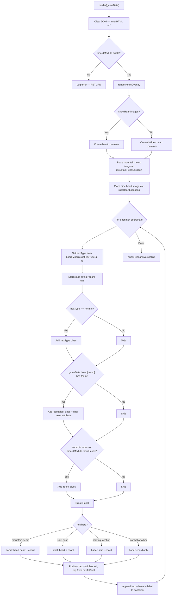
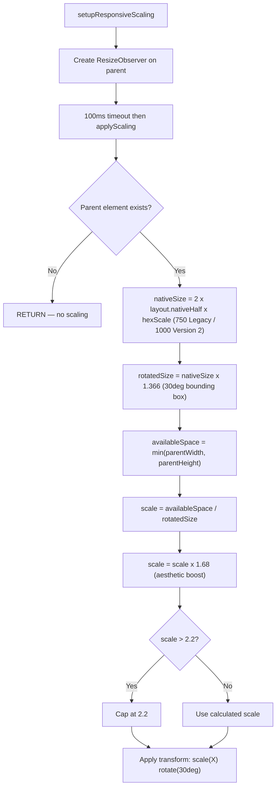
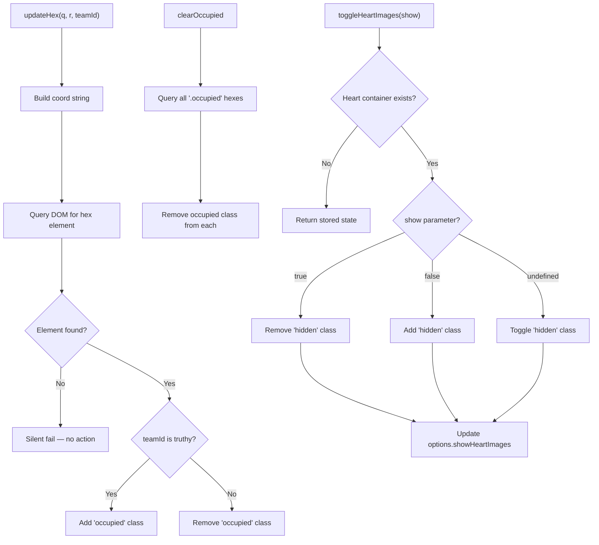

# board-renderer.js — Logic Diagrams

> Source: `BoardGame/shared/scripts/board-renderer.js`
> Hex grid visualization with responsive scaling, heart overlays, and incremental updates.
> Pure rendering layer — delegates coordinate math to external `boardModule`.

## 1. Render Pipeline

## 2. Responsive Scaling

## 3. Incremental Updates

## Board versions

The board's size is not hardcoded. `shared/scripts/board-layouts.js` defines Legacy (version 1, 91 hexes) and Version 2 (169 hexes). A tournament stores `boardVersion`; a missing field means Legacy. `BoardModule` takes a layout (default Legacy) and `BoardLayouts.sync(boardModule, boardRenderer, tournamentDoc)` switches a page's existing board to the tournament's layout when the doc loads. Version 2 reuses the 91 existing tile images: inner hexes show their own tile, and the outer two rings MIRROR the inner tiles (each side of the radius-5 hexagon acts as a mirror; `BoardLayouts.mirrorIntoArt` / `artCoordFor`). The art of the Legacy side-heart hexes moves to the new Version 2 side hearts, and the six old heart spots show their inward neighbour's tile (the frozen `artSwaps` table on the layout). Real art later just means adding the tiles and raising `artRadius` to 7; mirroring then stops by itself. Each board version has its own default-rooms doc: `config/defaultRooms` (Legacy) and `config/defaultRoomsV2` (Version 2), selected by `layout.defaultRoomsDocId`. `LOCAL_DEFAULT_ROOMS` is Legacy; `LOCAL_DEFAULT_ROOMS_V2` is intentionally empty.
